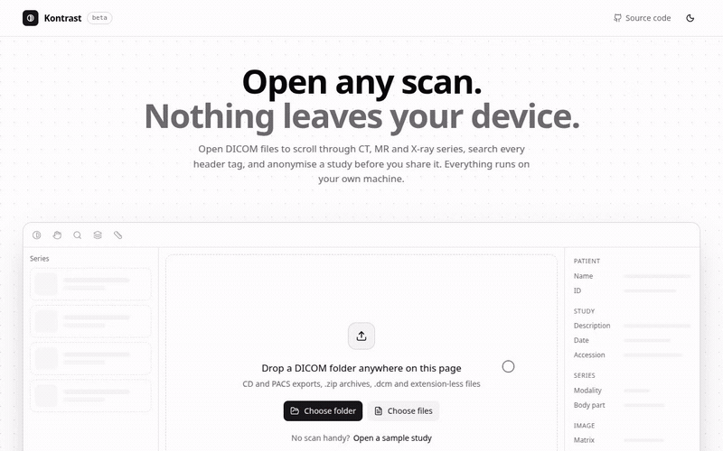

# Kontrast

**Open any scan. Nothing leaves your device.**

**[Try it at evertdeman.github.io/kontrast](https://evertdeman.github.io/kontrast/)**

Kontrast is a DICOM viewer that runs entirely in your browser. Drop in a folder, a few files or a zip from a hospital CD or PACS export, scroll through the series, search every header tag, and anonymise a study before you share it. There is no server and no upload: your files never leave your computer.



> [!IMPORTANT]
> **Kontrast is not a medical device.** It is a tool for opening and inspecting DICOM files for general, non-clinical purposes such as learning, curiosity and software development. Do not use it for diagnosis, treatment or any other medical decision. It is provided as is, without warranty.

## Features

**Opening files**

- Folders, individual files and `.zip` archives (including zips inside zips and large ZIP64 archives), by drag and drop or file picker
- CD and PACS exports: files with no extension, files named by UID, `DICOMDIR` folders
- Multi-frame files such as ultrasound clips and enhanced CT/MR, one image per frame
- Common compressions: JPEG baseline and lossless, JPEG-LS, JPEG 2000, HTJ2K, JPEG XL and RLE
- Names and text in the file's own character set, including UTF-8, Cyrillic, Japanese, Korean and Chinese
- A clear summary of anything skipped and why (not DICOM, no image, unsupported compression such as video, damaged zip, already open)

**Viewing**

- Studies and series grouped automatically, with thumbnails, and slices ordered by their position in the body
- Scroll through slices or play a series on a loop
- Window/level, with CT presets (soft tissue, lung, bone, brain, subdural, liver), invert, zoom, pan and reset
- Measurements: length, angle, and elliptical regions with Hounsfield statistics
- Orientation markers (head/feet, left/right, front/back) derived from the image geometry, including X-rays
- Save the current view as a PNG
- Light and dark themes

**Inspecting**

- A header panel with the key patient, study, series and image fields; collapsible and resizable
- The full header, including nested sequences and private tags, with search across tags, keywords and values
- Study details: patient, study and every series with its image count, scan range and acquisition time

**Anonymising**

- Removes identifying details from the headers, following the DICOM Basic Application Level Confidentiality Profile (PS3.15 Annex E), and replaces UIDs consistently across the study
- Dates can be shifted by a random number of days (keeping intervals), removed or kept; age, sex, height and weight can be kept
- Save the result as a zip, or open it in Kontrast to check it first
- Warns about images that may have text burned into the pixels, which header anonymisation does not remove

**Editing for testing**

- Set, add or remove tags across a study or one series, to make test data for your own software
- Values that break the standard are allowed, with a warning; copies get new UIDs by default so they can't be mistaken for the originals

### Keyboard shortcuts

| Key | Action |
| --- | --- |
| `W` `P` `Z` `S` | Window/level, pan, zoom and scroll tools |
| `L` `A` `E` | Length, angle and elliptical region tools |
| `1`–`6` | CT window presets |
| `I` | Invert |
| `R` | Reset view |
| `C` | Save a screenshot |
| `↑` `↓` | Previous / next slice |
| `Space` | Play / pause |
| `H` | Full header |
| `T` | Show / hide the header panel |

With the mouse, the left button uses the selected tool, the right button zooms, the middle button pans and the wheel scrolls through slices.

## Privacy

Everything happens in your browser. Files are read into the tab's memory and are gone when you close or reload it. Nothing is uploaded, and there are no analytics or tracking. The [privacy page](https://evertdeman.github.io/kontrast/#privacy) lists exactly what your browser stores: a few settings, nothing about your files.

The build also carries a Content-Security-Policy with `connect-src 'self'`, so the browser itself refuses any connection from the app to another server.

### Verify it yourself

You don't have to take this on trust:

1. **Watch the network.** Open your browser's developer tools on the **Network** tab and tick *Preserve log*. Then open, view, anonymise and save your own files. You will only see `GET` requests for the app's own code files the first time they are needed (for example `decodeImageFrameWorker-….js` or a WebAssembly image decoder), and `blob:` entries, which exist only inside your browser. There are no `POST` or `PUT` requests and nothing goes to another domain.
2. **Pull the plug.** Load the app and open the sample study once, so its image decoders are loaded. Then switch the Network tab to *Offline*, or disconnect from the internet, and open your own files. Viewing, searching the header and anonymising still work. (Files that use a compression the sample doesn't may need their decoder to load first.)
3. **Read the policy.** View the page source: the first tag in `<head>` is the Content-Security-Policy, with `connect-src 'self'`.
4. **Run the tests.** `pnpm test:e2e --grep privacy` uses the app the way a visitor would and fails if it contacts another server, sets a cookie or stores more than the privacy page lists.

## Running it locally

Requirements: [Node.js](https://nodejs.org/) 22.12 or later and [pnpm](https://pnpm.io/) 12.

```bash
pnpm install
pnpm dev        # start the development server
```

Then open the URL it prints, usually <http://localhost:5173>. No scan to hand? Choose **Open a sample study** on the start page.

Other commands:

```bash
pnpm build      # type-check and build a static site into dist/
pnpm preview    # serve the production build locally
pnpm test       # unit tests (Vitest)
pnpm test:e2e   # end-to-end tests (Playwright), against the production build
pnpm typecheck  # TypeScript only
pnpm lint       # oxlint
pnpm demo       # record the README demo into docs/demo.webm
```

The end-to-end tests need Playwright's browsers once: `pnpm exec playwright install chromium firefox`.

The production build is a static site, so it can be served from any static host.

### Sample study

The sample study in `public/sample.zip` is a simulated brain MRI with two co-registered series, Axial T1 and Axial FLAIR. The anatomy comes from the [ICBM152 2009 nonlinear-symmetric template](https://nist.mni.mcgill.ca/icbm-152-nonlinear-atlases-2009/) — an *average* of 152 brains, not a real, identifiable patient — and the T1 and FLAIR contrast is synthesised from its tissue maps. It contains no real patient data.

To regenerate it you need Python with `numpy`, `scipy`, `pydicom`, `nibabel` and `pylibjpeg-openjpeg`, and the template's NIfTI files (download `mni_icbm152_nlin_sym_09a_nifti.zip` from the [ICBM page](https://nist.mni.mcgill.ca/icbm-152-nonlinear-atlases-2009/) and unzip it):

```bash
python scripts/generate_sample.py path/to/mni_icbm152_nlin_sym_09a
```

### Test files (optional)

For manual testing against a wide range of real-world DICOM variants, you can fetch the [pydicom](https://github.com/pydicom/pydicom) test files into `test-data/`, which is ignored by git:

```bash
git clone --depth 1 --filter=blob:none --sparse https://github.com/pydicom/pydicom.git test-data/pydicom-repo
git -C test-data/pydicom-repo sparse-checkout set src/pydicom/data/test_files
git clone --depth 1 https://github.com/pydicom/pydicom-data.git test-data/pydicom-data-repo
```

## Built with

- [Cornerstone3D](https://www.cornerstonejs.org/) for rendering and image decoding
- [dicom-parser](https://github.com/cornerstonejs/dicomParser) and [dcmjs](https://github.com/dcmjs-org/dcmjs) for reading headers
- [fflate](https://github.com/101arrowz/fflate) for writing zips
- React, TypeScript and Vite
- Tailwind CSS, [shadcn/ui](https://ui.shadcn.com/) and [Radix](https://www.radix-ui.com/)
- Vitest for unit tests and Playwright for end-to-end tests

## Project layout

```text
src/
  components/         UI: landing page, studies list, viewer
    viewer/           toolbar, viewport, series rail, header panel
  lib/
    cornerstone/      Cornerstone setup, image registration, study grouping
    dicom/            pure DICOM logic: parsing, header formatting, geometry
    files.ts          file pickers, drag and drop, unpacking archives
    zip.ts            streaming zip reader
    exportZip.ts      anonymised and edited copies, saved as zips
  test/               test helpers (an in-memory DICOM writer)
tests/
  e2e/                end-to-end tests
  demo/               the scripted README demo
docs/                 README media
scripts/              sample study generator
public/sample.zip     bundled sample study (simulated brain MRI)
```

## Releases

Versioning follows [Semantic Versioning](https://semver.org/) and is automated with [semantic-release](https://semantic-release.org/). On every push to `main`, the release workflow derives the next version from the [Conventional Commits](https://www.conventionalcommits.org/) made since the last release, updates `CHANGELOG.md` and `package.json`, tags the commit and publishes a GitHub Release. Commit messages therefore drive the version:

- `fix: …` → patch release (`0.0.x`)
- `feat: …` → minor release (`0.x.0`)
- `feat!: …`, or any commit with a `BREAKING CHANGE:` footer → major release (`x.0.0`)

Other types (`chore:`, `docs:`, `ci:`, `refactor:`, `test:`, …) are recorded but do not trigger a release on their own.

## Status

Kontrast is in early development. Expect rough edges.

## Contributing

Bug reports and ideas are very welcome: please open an issue if a file does not open or displays incorrectly, or if something could work better. Describe the file (modality, where it came from, transfer syntax) but **never attach real patient data**.

Code contributions are not accepted at the moment: all code is written by the author, which keeps the licensing simple. Please do not open pull requests with code changes.

## Licence

Kontrast is source-available under the [PolyForm Noncommercial License 1.0.0](LICENSE), with one added permission.

In plain words:

- **Running the app is free for everyone, including commercial use.** Open scans in the [hosted version](https://evertdeman.github.io/kontrast/) or in a copy you run yourself, for any purpose, including paid work.
- **Copying the code is free for non-commercial purposes** — personal use, study, research, teaching, or use by charities and public institutions. You may copy, modify and share the source.
- **Copying, modifying or redistributing the code for commercial gain requires a separate licence from the author.**

This summary is for convenience only; the [licence text](LICENSE) is what applies.

Third-party libraries are used under their own licences.

The bundled sample study is derived from the ICBM152 2009 nonlinear-symmetric template, © 1993–2004 Louis Collins, McConnell Brain Imaging Centre, Montreal Neurological Institute, McGill University, used under its permissive licence (use, copy, modify and distribute for any purpose, provided the copyright notice is retained). See Fonov et al., *NeuroImage* 2011 and 2009.
